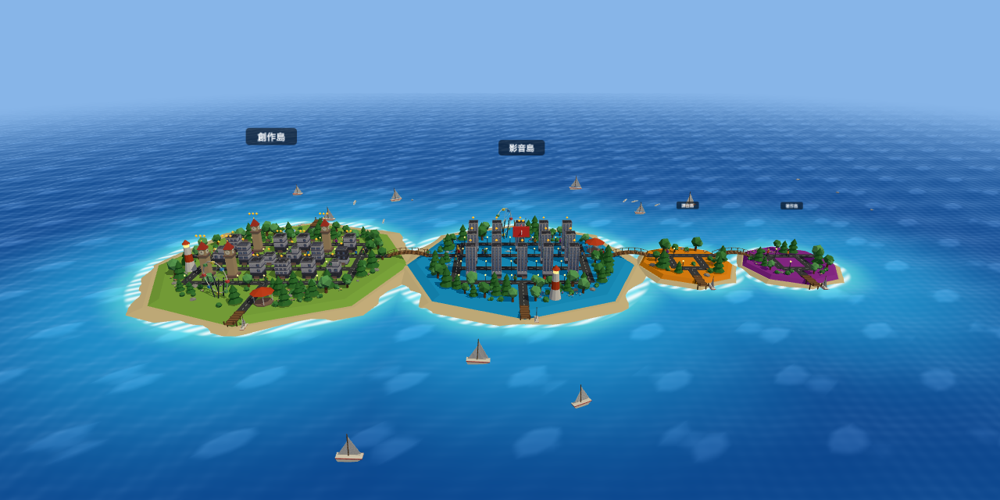
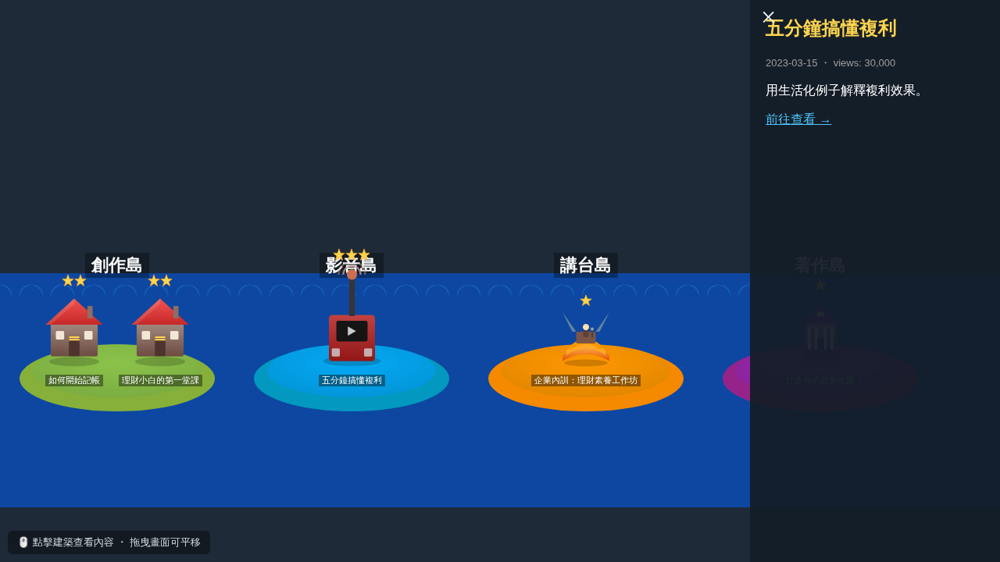

# 🏝️ Portfolio City｜個人履歷模擬城市

把部落格文章、YouTube 影片、演講紀錄、出版著作等個人輸出，轉化成一座可探索的模擬城市／島嶼建設遊戲，讓履歷不再只是條列式文字，而是一座能讓人逛、能點擊互動的小世界。




## ✨ 核心概念

- **分區島嶼**：依內容類型分區（創作島=部落格、影音島=YouTube、講台島=演講、著作島=書籍），之後可自由擴充更多分區。
- **建築即內容**：每一棟建築對應一筆內容紀錄，點擊建築會彈出側邊面板顯示標題、數據、摘要與連結。
- **等級成長**：依內容成效（瀏覽數、出席人數等）自動決定建築大小與星星等級，數字越漂亮、城市越繁榮。
- **資料驅動**：所有分區與內容都讀取 `public/content.json`，新增內容不需要改程式碼。
- **城市隨內容成長**：作品越多，島嶼越大、道路越多、設施越齊全，居民也越多。
- **特色地標**：高等級的項目會變成特製建築（`src/landmarks3d.js`）：部落格 Lv.2 為鐘塔、影片 Lv.1 起為播放鍵塔、演講為露天劇場、著作為書塔；一般部落格建築會依 id 變換外觀。
- **依年份分組**：單一島嶼項目超過 24 筆（`GROUP_THRESHOLD`，`src/main3d.js`）時，同分類的項目會依年份合併成一幢地標建築，點擊後在側欄列出該年所有文章。
- **互動與生活感**：行人會在島上與橋上走動，點擊行人會冒出對話氣泡；另有海面 shader、碼頭、小船與海鷗。

## 📂 專案結構

```
portfolio-city/
├── index.html          # 預設首頁：3D 版 (Three.js，由 Vite 打包)
├── city2d.html         # 2D 版 (Phaser)，僅開發模式可用：/city2d.html
├── vite.config.js      # Vite 設定 (base 為相對路徑)
├── public/             # 靜態檔案，原樣複製到 dist/
│   ├── content.json         # 資料模型：分區 (districts) 與內容項目 (items)
│   ├── assets/              # 2D 美術素材 (SVG)
│   │   ├── models/kenney-city/   # 3D 建築模型 (Kenney City Kit, CC0)
│   │   └── *.svg                 # 2D 建築、島嶼基座、星星徽章
│   └── vendor/              # Phaser 執行檔 (由 npm postinstall 自動產生，不入版控)
├── src/
│   ├── main3d.js         # 3D 場景：島嶼、Kenney 建築模型、植物裝飾、互動面板
│   ├── ocean3d.js        # 水面 shader 與波浪公式
│   ├── props3d.js        # 碼頭、橋梁、小船、海鷗、行人
│   └── main.js           # 2D 版 Phaser 場景邏輯
├── scripts/copy-vendor.js # 安裝後自動複製 Phaser 到 public/vendor/
├── .github/workflows/deploy.yml  # 推到 main / scaffold 時自動部署到 GitHub Pages
└── docs/                 # README 用截圖
```

## 🚀 本機啟動

需求：Node.js 18+

```bash
npm install     # 安裝相依套件
npm start       # Vite 開發伺服器 (http://localhost:5173)，修改後自動重新載入
npm run build   # 打包到 dist/
npm run preview # 預覽打包結果
```

## ☁️ 部署到 GitHub Pages

1. 到 repo 的 **Settings → Pages**，Source 選 **GitHub Actions**。
2. 把程式合併到 `scaffold`（或 `main`），`.github/workflows/deploy.yml` 會自動建置並發佈，網址為 `https://<帳號>.github.io/portfolio-city/`。

也可以把 `dist/` 上傳到 Cloudflare Pages、Netlify 等任何靜態主機。2D 版不會被打包進 `dist/`。

## 🌱 城市成長規則

作品越多，島嶼越大、道路與路燈/長椅越多，並依數量解鎖設施：3 件起有噴水池、4 件起有涼亭、6 件起有燈塔與第二座碼頭、9 件起有摩天輪。行人、小船、海鷗也隨作品總數增加（行人與海鷗各有數量上限，避免超大島嶼效能下降）。

可在網址加上 `?demo=N`（例如 `http://localhost:5173/?demo=6`）為每個區域額外塞入 N 件假作品來預覽。

## ✏️ 新增你的內容

編輯 `public/content.json`，在 `items` 陣列中新增一筆資料即可，例如新增一篇部落格文章：

```json
{
  "id": "blog-003",
  "district": "creative",
  "category": "blog",
  "title": "我的新文章標題",
  "date": "2025-01-01",
  "metric": { "views": 8000 },
  "link": "https://your-blog.com/post",
  "description": "一句話摘要。"
}
```

- `district`：對應 `districts` 陣列中的分區 `id`
- `category`：`blog` / `youtube` / `speech` / `book`，決定使用哪個建築美術素材
- `metric`：取第一個數值判斷等級門檻（目前：≥20000 為 Lv.2、≥5000 為 Lv.1、其餘 Lv.0），`getLevel()` 在 `src/main3d.js`（3D）與 `src/main.js`（2D）各有一份。`metric` 可省略（留空 `{}`），此時為 Lv.0。目前創作島已匯入 `note.duranhsieh.com` 與 `dog0416.blogspot.com` 的部落格文章。

## 🔗 嵌入部落格或 GitHub Profile

**部落格（支援 HTML 的平台，如 Blogger）**：加上 `?embed=1` 會隱藏標題與操作提示，並減少海鷗、行人數量以節省效能。

```html
<iframe src="https://matsurigoto.github.io/portfolio-city/?embed=1" width="100%" height="600" style="border:0" loading="lazy" allowfullscreen></iframe>
```

**GitHub Profile README**：GitHub 會過濾 `<iframe>` 與 JavaScript，改放預覽圖並連到網站：

```md
[](https://matsurigoto.github.io/portfolio-city/)
```

`docs/preview.png` 可用 headless 瀏覽器重新擷取 `?embed=1` 畫面更新。

## 🎨 美術素材說明

3D 版建築使用 [Kenney City Kit (Commercial)](https://kenney.nl/assets/city-kit-commercial)（CC0），其餘樹木、設施、橋梁、船、行人皆為程式產生。2D 版使用 `public/assets/` 內的原創手繪 SVG（等角簡化風格），可直接替換成你自己的美術圖，只要維持相同檔名與尺寸比例即可。

## 🗺️ 後續可擴充方向

- 時間軸拖曳：依年份動態顯示城市擴張過程
- 更多分區：榮譽廣場（得獎/合作里程碑）、市政中心（關於我/聯絡方式）
- 音效與過場動畫（搭船/起飛切換分區）
- 串接 CMS 或 RSS，自動產生 `content.json`，免手動維護
